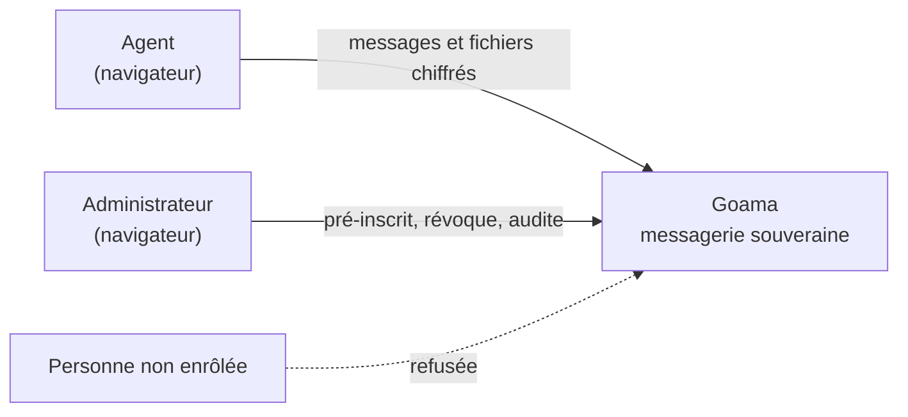
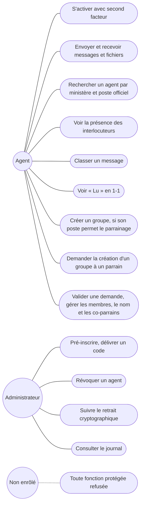
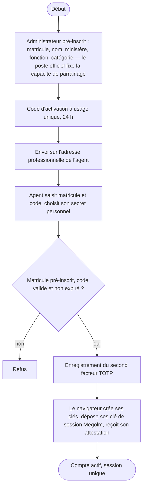
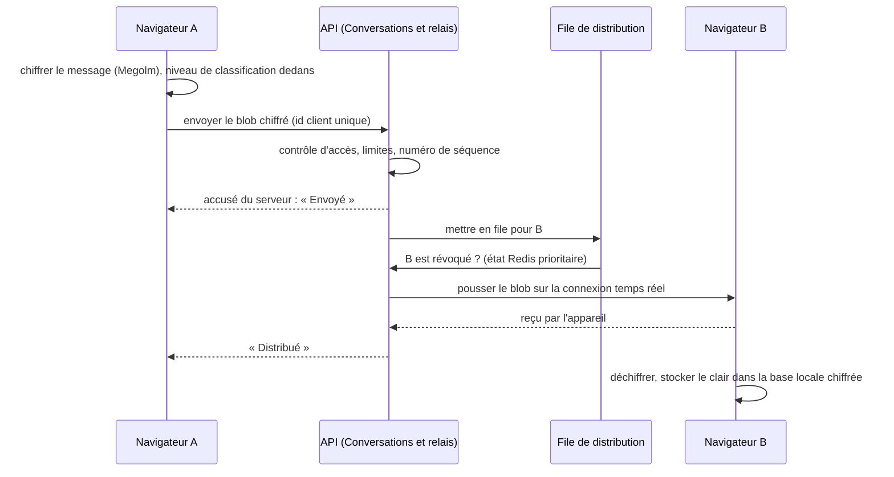
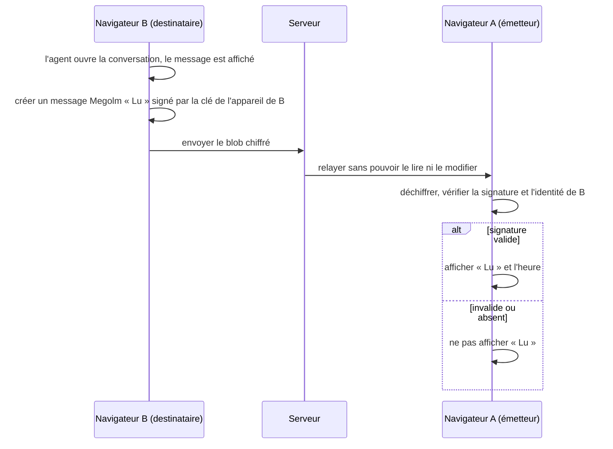
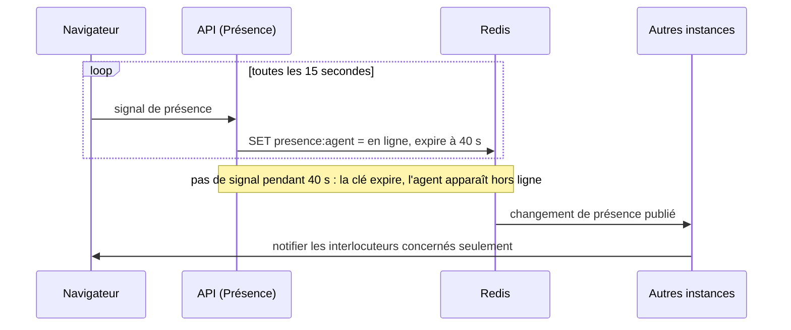
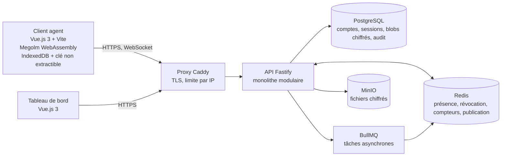
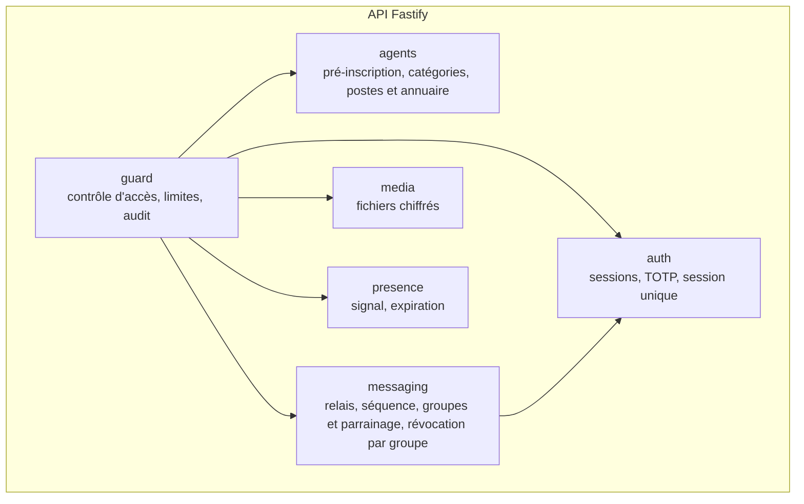
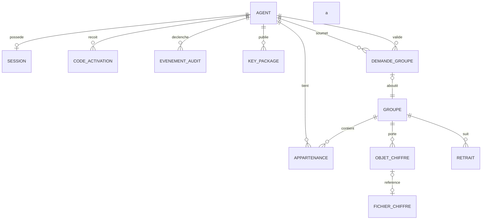

# Modélisation — C4 et UML

**Version :** 0.5 · **Date :** 31 octobre 2026
Les modèles dérivent des composants de `04_transition_req_to_arch.md`. Les diagrammes sont en Mermaid et n'ont pas été rendus automatiquement : à relire dans un visualiseur (GitHub les affiche). Pour chaque modèle : *exigences · frontière de confiance · échec · test*.

---

## M-01 — Contexte (C4 niveau 1)



| | |
|---|---|
| Exigences | REQ-ID-001, REQ-AUTHZ-002, C-03 |
| Frontière | Les navigateurs des agents voient le contenu ; le serveur non |
| Échec | Aucun service externe |
| Test | T-001, T-055 |

## M-02 — Cas d'utilisation



| | |
|---|---|
| Exigences | REQ-AUTHZ-002, 003, 005, 006 · REQ-GRP-001 à 009 |
| Refus explicites | L'Administrateur ne lit aucun contenu et n'agit sur aucun groupe ; un agent sans capacité de parrainage ne crée pas de groupe et ne peut que demander |
| Test | T-010, T-011, T-063 à T-067 |

## M-03 — Activité : pré-inscription et activation



| | |
|---|---|
| Exigences | REQ-ID-001 à 004 · REQ-SEC-003, 006 |
| Frontière | Les clés sont créées et restent dans le navigateur |
| Échec | Code expiré, réutilisé ou e-mail refusé ; matricule inconnu ; second facteur non enregistré |
| Test | T-001 à T-004 |

## M-04 — Séquence : message 1-1 avec états (G-11)



| | |
|---|---|
| Exigences | REQ-MSG-001 à 006 · REQ-REV-003 · REQ-ABUSE-001 à 006 |
| Frontière | Le clair n'existe que sur A et B |
| Échec | Coupure : le message reste « envoyé » sans « distribué » ; renvoi sans doublon |
| Test | T-014, T-015, T-017, T-018 |

## M-05 — Séquence : accusé « Lu » à valeur probante (G-08)



| | |
|---|---|
| Exigences | REQ-RCPT-001 à 004, 006 |
| Frontière | Le serveur relaie un blob opaque et ne peut en fabriquer un |
| Échec | Accusé altéré : rejeté, jamais affiché |
| Limite | La signature prouve qu'un appareil enrôlé a affiché le message, pas que l'agent l'a lu ni sa valeur légale |
| Test | T-025, T-026, T-027 |

## M-06 — Séquence : révocation en deux temps (G-04, G-05)

```mermaid
sequenceDiagram
  participant IT as Administrateur
  participant S as API
  participant R as Redis
  participant M as Membre en ligne
  participant X as Navigateur révoqué
  IT->>S: révoquer l'agent
  S->>S: statut = révoqué, session invalidée (PostgreSQL)
  S->>R: liste noire du jeton, publier la révocation
  R-->>S: l'instance du révoqué ferme sa connexion
  S-->>X: connexion coupée, requêtes refusées (5 s au plus)
  S->>S: état du retrait = en attente, par groupe ; audit
  S->>M: avis de révocation
  alt un membre est en ligne
    M->>M: retirer l'agent du groupe (nouveau commit)
    M->>S: soumettre le commit (epoch attendue)
    S->>S: état du retrait = terminé
  else aucun membre en ligne
    S->>S: état = en attente ; alerte après 24 h
  end
  IT->>S: consulter les états (compte, session, retrait par groupe)
  X->>X: tenter d'effacer les données locales (non garanti)
```

| | |
|---|---|
| Exigences | REQ-REV-001 à 008 · REQ-OPS-003, 004 |
| Frontière | Le serveur ne détient aucune clé de groupe : il ne peut pas retirer lui-même |
| Échec | Retrait impossible : « en attente » ou « échec » visible, jamais « terminé » |
| Test | T-038 à T-042, T-057 |

## M-07 — Séquence : présence en ligne (G-10)



| | |
|---|---|
| Exigences | REQ-DIR-002 à 005 · INV-008 |
| Frontière | La présence ne sort jamais de Redis et n'est jamais écrite en PostgreSQL |
| Échec | Réseau coupé : l'agent passe hors ligne au plus 40 s plus tard |
| Test | T-030 à T-033 |

## M-08 — États d'un message classifié

```mermaid
stateDiagram-v2
  [*] --> Normal
  [*] --> Restreint
  [*] --> Confidentiel
  Restreint --> Restreint: transfert, copie, export bloqués
  Confidentiel --> Confidentiel: transfert, copie, export bloqués ; filigrane
  Confidentiel --> Supprime: délai choisi écoulé (7 jours au plus)
  Normal --> [*]
  Restreint --> [*]
  Supprime --> [*]
```



| | |
|---|---|
| Exigences | REQ-CLS-001 à 005 |
| Frontière | Le niveau est dans le message chiffré, pas visible du serveur |
| Limite | Application des restrictions par le client ; aucune protection contre une photo d'écran |
| Test | T-034 à T-037 |

## M-09 — Conteneurs (C4 niveau 2)



| | |
|---|---|
| Exigences | REQ-OPS-001, 006 · REQ-SEC-005, 007 · C-12 |
| Frontières | Navigateur / réseau / serveur ; PostgreSQL, Redis et MinIO ne contiennent que du chiffré hormis l'annuaire |
| Test | T-055, T-015 |

## M-10 — Composants de l'API (C4 niveau 3)



Les six composants correspondent aux six groupes de `04_transition_req_to_arch.md` (le cœur cryptographique vit dans le client). Tout appel passe par `guard`.

## M-11 — Modèle de données conceptuel



Notions : AGENT (matricule, nom, ministère, poste officiel, catégorie, capacité de parrainage, rôle, statut) · SESSION (une seule par agent) · GROUPE (identifiant aléatoire, epoch, statut actif ou gelé, nom transporté chiffré) · APPARTENANCE (rôle créateur, parrain, co-parrain ou membre) · DEMANDE_GROUPE (objets, agents pressentis, demandeur, parrain validant, statut) · OBJET_CHIFFRE (séquence, blob opaque) · FICHIER_CHIFFRE · RETRAIT (état du retrait de l'agent, par groupe : en attente, terminé, échec) · EVENEMENT_AUDIT (sans contenu). Les noms et champs détaillés de ces entités, et le cycle de vie associé, figurent dans `09_data_model.md`. La présence n'est pas dans ce modèle : elle vit dans Redis (INV-008). Aucune entité ne prévoit la suppression d'un compte : un agent révoqué reste une trace (REQ-OPS-013).

| | |
|---|---|
| Exigences | REQ-ID-006, 008 · REQ-GRP-001 à 009 · REQ-REV-005 · REQ-AUD-002 · REQ-OPS-013 |
| Où sont les secrets | Aucun secret de contenu ; TOTP chiffré, secret personnel haché |
| Test | T-006, T-008, T-044 |

## M-12 — Séquence : demande de création d'un groupe (G-01)

```mermaid
sequenceDiagram
  participant D as Demandeur (poste non habilité)
  participant S as API (Groupes)
  participant P as Parrain (poste habilité)
  participant A as Navigateur du parrain
  D->>S: demander la création d'un groupe (objet, agents pressentis)
  S->>S: vérifier que le demandeur n'a PAS la capacité de parrainage, que les agents pressentis sont actifs ; auditer la demande
  S-->>P: notification de demande en attente
  alt le parrain refuse
    P->>S: refuser la demande
    S-->>D: refus notifié ; aucun groupe créé
  else le parrain valide
    P->>S: valider la demande
    S->>S: vérifier la capacité de parrainage du poste du parrain ; auditer la validation avec son identité
    S->>S: créer le groupe, ajouter le demandeur avec le rôle créateur et le parrain avec le rôle parrain
    A->>A: dérouler l'ajout Megolm : clé de session Megolm, clé de session Megolm, commit (nouvel epoch)
    S-->>D: le groupe existe ; les membres pressentis rejoignent
  end
```

| | |
|---|---|
| Exigences | REQ-AUTHZ-005, 006 · REQ-GRP-001 à 003 · REQ-AUD-001 |
| Frontière | Le serveur décide des rôles, jamais du contenu : la rotation Megolm est soumis par le navigateur du parrain |
| Échec | Parrain non habilité, agent pressenti non actif, refus : aucun groupe créé, les deux cas audités |
| Test | T-063, T-064, T-065 |
