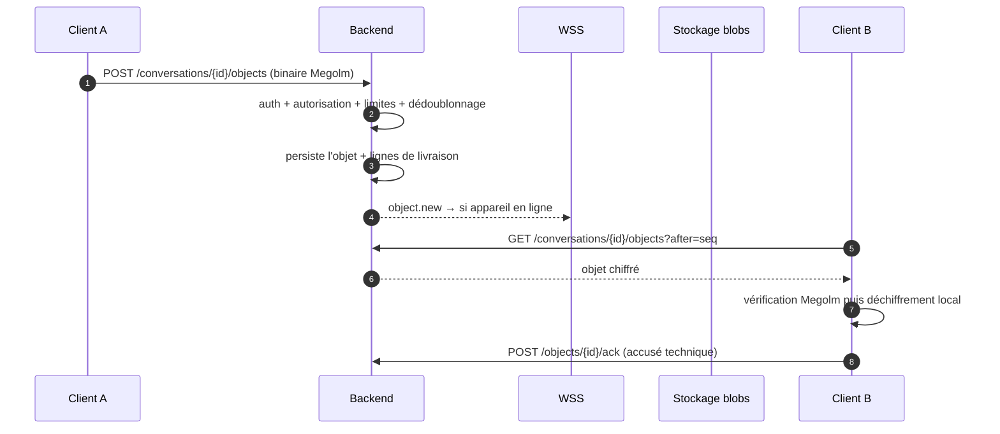

# Interfaces — API REST et WebSocket

**Version :** 0.5 · **Date :** 31 octobre 2026 · **Statut :** base d'implémentation (fusion du contrat d'API du dossier `brouillon/`, décision de l'équipe), adaptée aux décisions : parrainage sans périmètre (ADR-12), code par e-mail 24 h, aucun code de secours en libre-service, aucune suppression de compte.

| | |
|---|---|
| Base path | `/api/v1` |
| Adapter | PostgreSQL (source de vérité), Redis (volatils), MinIO (blobs chiffrés) |
| Références | `02_requirements_srs.md` (exigences) · `03_design_contract_invariants.md` (garanties) · `09_data_model.md` (entités) |

---

## 1. Conventions communes

| Convention | Règle |
|---|---|
| Transport | HTTPS (REST) et WSS (WebSocket) uniquement |
| Authentification | Jeton de session (bearer) après MFA validé ; une session = un appareil (REQ-ID-006) |
| Formats | JSON pour les métadonnées ; octets binaires bruts pour les payloads Megolm et les blobs |
| Erreurs | Structure unique : `{ "code", "message", "request_id" }` — pas de détail interne ni de secret (REQ-SEC-008, G-07) |
| Idempotence | Toute publication porte un `client_id` fourni par le client ; la réémission ne duplique pas |
| Pagination | Curseur (`?after=<seq>&limit=50`) sur les listes d'objets |
| Autorisation | Contrôle serveur en un point unique, appliqué à toute route (REQ-AUTHZ-001) |

---

## 2. API REST — surface

| Zone | Endpoints | Exigences |
|---|---|---|
| **Authentification** | `POST /auth/login` (identifiant + secret + TOTP), `POST /auth/logout`, `POST /auth/refresh`, `POST /auth/mfa/totp` (enregistrement), `DELETE /auth/mfa/totp` (désenregistrement), `POST /auth/mfa/reset-request` (demande adressée à l'Administrateur ; aucune régénération en libre-service) | REQ-ID-004, 005, 009 |
| **Amorçage** | Provisionnement automatique de l'administrateur et des comptes de démonstration au premier démarrage du conteneur API (script d'amorçage interne, aucune route HTTP ; refusé si un Administrateur existe) | REQ-OPS-012 |
| **Appareils** | `POST /devices/enrollment-authorizations` (Administrateur ; génère le code, envoi e-mail, expiration 24 h), `POST /devices/enrollment-authorizations/{id}/resend` (annule et remplace le code), `POST /devices/enroll` (matricule + code + clé publique locale), `GET /devices`, `DELETE /devices/{id}` (révocation d'un appareil par l'Administrateur) | REQ-ID-001 à 003, 009 · REQ-SEC-003 |
| **Comptes et annuaire** | `GET /account/me`, `GET /accounts` (annuaire des agents actifs ; matricule jamais renvoyé), `GET /accounts?ministere=&fonction=` (recherche), `GET /accounts/{id}` (fiche d'annuaire) | REQ-DIR-001, 006 |
| **Conversations** | `POST /conversations` (parrain direct : refuse si le poste ne confère pas la capacité), `POST /group-requests` (demande), `POST /group-requests/{id}/approve`, `POST /group-requests/{id}/reject`, `GET /group-requests` (les demandes entrantes et sortantes de l'agent), `GET /conversations`, `GET /conversations/{id}`, `POST /conversations/{id}/members`, `DELETE /conversations/{id}/members/{agentId}`, `POST /conversations/{id}/leave`, `PATCH /conversations/{id}` (co-parrains, renommage via objet chiffré), `POST /conversations/{id}/suspend`, `POST /conversations/{id}/resume`, `DELETE /conversations/{id}` (suppression du groupe) | REQ-AUTHZ-005, 006 · REQ-GRP-001 à 009 |
| **Objets crypto** | `GET /devices/olm-keys/status` (stock de pré-clés publiques), `POST /devices/olm-keys` (publication des identités et pré-clés signées), `POST /groupes/{id}/olm-keys` (identités des membres et réclamation atomique d'une pré-clé), `DELETE /admin/agents/{agentId}/olm-keys` (réinitialisation exceptionnelle auditée), `POST /groupes/{id}/messages` (enveloppe Megolm ou partage Olm opaque), `GET /groupes/{id}/messages` (rattrapage par séquence) | REQ-MSG-001 à 005 · REQ-CLS-001 |
| **Médias** | `POST /media` (méta), `PUT /media/{id}/blob` (binaire chiffré), `GET /media/{id}/blob`, `GET /conversations/{id}/media` | REQ-FILE-001 à 004 |
| **Présence** | `POST /presence` (signal ; écrit dans Redis seulement), `GET /conversations/{id}/presence` | REQ-DIR-002 à 005 |
| **Administration** (routes sous `/admin`) | `GET /admin/reference-data` (catégories, ministères et postes officiels), `GET /admin/accounts?page=1&limit=25` (réponse paginée `{items, page, limit, total, totalPages}`, y compris révoqués), `POST /admin/accounts` (pré-inscription puis envoi du code), `POST /admin/accounts/{id}/revoke` (révocation définitive), `POST /admin/accounts/{id}/suspend` (suspension temporaire), `POST /admin/accounts/{id}/reactivate` (réactivation d'un compte suspendu), `DELETE /admin/devices/{id}` (révocation d'appareil), `GET /admin/retentions?page=1&limit=25` et `GET /admin/audit-events?page=1&limit=25` (même enveloppe paginée) | REQ-REV-001 à 008 · REQ-OPS-013 · REQ-AUD-001 à 004 |

**Routes absentes à dessein** : toute suppression de compte (REQ-OPS-013), toute action d'administration sur les groupes (REQ-GRP-005), toute lecture d'administration du contenu (G-06), tout libre-service de régénération du second facteur (REQ-ID-009).

### 2.1 Règles de sécurité applicatives

Les listes d'administration sont paginées côté serveur. `page` commence à 1,
le front demande 10 éléments par page (`limit=10`) et le serveur plafonne toute
demande à 100. Chaque réponse contient
`items`, `page`, `limit`, `total` et `totalPages`; le client doit utiliser
`totalPages` pour afficher la navigation et ne doit pas supposer que la
première réponse contient toute la liste.

- Chaque route DOIT vérifier : session valide (REQ-ID-007), appareil enrôlé, autorisation métier — en un point de contrôle unique (REQ-AUTHZ-001, G-01).
- Toute route protégée DOIT refuser une session dont le MFA n'a pas été validé.
- Les payloads Megolm et Olm DOIVENT rester opaques pour le serveur et être bornés en taille. Le serveur vérifie les signatures des identités et pré-clés publiques, puis relaie les enveloppes ; aucun partage de clé Megolm en clair n’est permis. Le flux reste à valider entre navigateurs.
- Les réponses d'erreur NE DOIVENT PAS révéler l'existence d'une ressource à un agent non autorisé.
- Les routes de création, de gestion et de suspension DOIVENT vérifier le rôle de **créateur** ou de **parrain** (valeurs `createur` / `parrain`, `09_data_model.md` §2.1) **et** la capacité de parrainage déduite du poste officiel ; aucune vérification de ministère, de structure ou de périmètre n'est appliquée (ADR-12).
- Les opérations d'administration sont limitées à 30 par minute (REQ-ABUSE-007) et auditées (REQ-AUD-001).

---

## 3. WebSocket — événements

Endpoint : `wss://<domaine>/api/v1/ws`. Authentification à la connexion (session valide). Rôle : **notification seule** ; la source de vérité reste REST.

| Événement serveur → client | Charge portée | Réaction client |
|---|---|---|
| `object.new` | conversation, type d'objet, séquence | déclenche une synchronisation REST |
| `conversation.updated` | id, raison (membres, epoch, renommage) | resynchronise la conversation |
| `group_request.new` · `group_request.decided` | id, statut | synchronise les demandes de groupe |
| `conversation.removed` | id | retire la conversation localement |
| `device.revoked` | id de l'appareil | invalide l'état local, puis la session |
| `presence.changed` | agent,état | met à jour l'indicateur |
| `sync.required` | — | lance une synchronisation REST |

| Événement client → serveur | Usage |
|---|---|
| `heartbeat` | maintien de connexion ; absence prolongée ⇒ présence expirée (REQ-DIR-002) |

### 3.1 Règles

- Aucun événement ne porte de contenu de conversation, ni d'adresse IP, ni de nom de groupe ; seules des références (ids, types, séquences).
- Une reconnexion ne « rattrape » pas une absence : le client lance immédiatement une synchronisation REST ; socket et REST s'appuient sur la même source de vérité.
- Une limite de connexion par session ; reconnexions propres au refresh ; fermeture immédiate en cas de révocation (G-04).

---

## 4. Cycle d'une publication complète (vue unifiée)

---

Les signatures exactes des champs restent à figer à l'implémentation (niveau 4 du C4) ; ce document fixe la surface et les garanties. Les entités correspondantes sont dans `09_data_model.md`.
