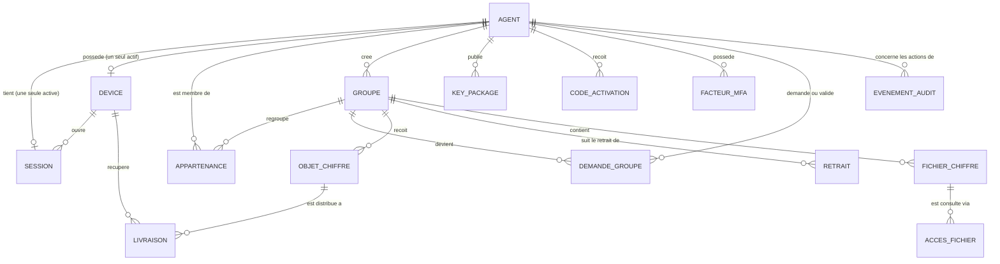

# Modèle de données — Goama

**Version :** 0.5 · **Date :** 31 octobre 2026 · **Statut :** base d'implémentation (fusion de l'ERD du dossier `brouillon/`, décision de l'équipe), adapté aux décisions : aucune suppression de compte, aucun code de secours en libre-service, code d'activation par e-mail 24 h, parrainage déduit du poste officiel sans périmètre.

| | |
|---|---|
| Base de données | PostgreSQL (source de vérité, sauf présence) |
| Références | `02_requirements_srs.md` · `03_design_contract_invariants.md` (G-02, G-07, G-10) · `08_interfaces_api.md` |

---

## 1. Principes

1. **Minimisation (G-10, REQ-SEC-008)** : une donnée est conservée uniquement si elle sert à la distribution, à l'autorisation ou à l'audit ; tout le reste n'est pas collecté.
2. **Le serveur ne contient jamais de clair (G-02)** : aucune table ne stocke de contenu de message en clair, de clé privée ni de secret de session ; les données d'annuaire nécessaires (nom, matricule, ministère, fonction, catégorie, poste) sont conservées en clair, fictives au sprint (INV-002).
3. **Contenu de contrôle / contenu de conversation** : les objets cryptographiques sont des **blobs opaques** ; le serveur ne juge jamais leur validité — seuls les clients le font.
4. **Aucune suppression de compte (REQ-OPS-013)** : un compte révoqué reste une trace ; seuls les contenus chiffrés suivent la purge des 30 jours (REQ-MSG-007) ; le journal d'audit est conservé 90 jours (REQ-AUD-004).

---

## 2. ERD — entités et relations

### 2.1 Entités

| Entité | Champs principaux | Règles |
|---|---|---|
| **AGENT** | `id` · `nom` · `matricule` (unique) · `ministere` · `fonction` (libellé d'annuaire) · `poste_officiel` (matrice du PRD) · `categorie` (P, A, B, C, D, E, hors catégorie) · `statut` (`pre_inscrit`, `actif`, `suspendu`, `revoque`) · horodatage | REQ-ID-008 · REQ-OPS-013 (aucun statut « supprimé ») · la capacité de parrainage se **déduit** du poste, jamais stockée comme un droit indépendant |
| **DEVICE** | `id` · `agent_id` · `libelle` · `cle_publique_mls` · `statut` (`pending`, `enroled`, `revoque`) · `enroled_le` · `revoque_le` | REQ-ID-009 · seules des clés publiques, jamais privées (G-13) |
| **SESSION** | `id` · `device_id` · `token_hash` (hachage, jamais le jeton) · `mfa_verifie_le` · `cree_le` · `expire_le` · `revoque_le` (null si active) | REQ-ID-006 (une seule active) · un agent n'a qu'un appareil (C-13) |
| **CODE_ACTIVATION** | `id` · `agent_id` · `code_hash` (jamais le code en clair) · `statut` (`en_attente`, `utilise`, `expire`, `annule`) · `envoye_le` · `expire_le` (**24 h après l'envoi**) · `utilise_le` | REQ-ID-002 · une seule `en_attente` par agent, l'émission annule la précédente |
| **FACTEUR_MFA** | `id` · `agent_id` · `type` (TOTP) · `secret_chiffre` (chiffrement au repos) · `statut` · horodatage | REQ-ID-003 · **aucun code de secours autogénéré** : perte du facteur ou de l'appareil = révocation puis nouvel enrôlement par l'Administrateur (REQ-ID-009, décision D12) |
| **GROUPE** | `id` aléatoire · `cree_par` · `type` (`individuel`, `groupe`) · `statut` (`actif`, `suspendu`, `gele`, `supprime`) · `epoch_courant` · horodatage. Aucun nom en colonne : le titre voyage dans le message chiffré | REQ-GRP-006 · REQ-GRP-008 · REQ-GRP-009 |
| **APPARTENANCE** | `id` · `groupe_id` · `agent_id` · `role` (`createur`, `parrain`, `co_parrain`, `membre`) · `statut` (`actif`, `parti`, `retire`) · `arrive_le` · `parti_le` | REQ-GRP-003, 004 · maintient toujours au moins un parrain actif (REQ-GRP-009) |
| **DEMANDE_GROUPE** | `id` · `demandeur_id` · `parrain_id` (null tant que non choisi) · `groupe_id` créé si validée · `statut` (`en_attente`, `validee`, `refusee`, `annulee`) · `decidee_le` | REQ-AUTHZ-006 · REQ-GRP-001/002 · aucune vérification de ministère ni de périmètre (ADR-12) |
| **KEY_PACKAGE** | `id` · `agent_id` · `publie_le` · `consomme_le` | REQ-SEC-006 · ajouté seulement si agent actif |
| **OBJET_CHIFFRE** | `id` · `groupe_id` · `appareil_expediteur` · `type` (`message_applicatif`, `commit_mls`, `welcome`, `key_package`) · `payload` (**binaire opaque chiffré**) · `seq_groupe` (ordre de publication) · `depose_le` · `purge_le` (30 jours REQ-MSG-007) | G-02 · la classification voyage **dans** le payload chiffré, jamais en colonne (G-09) |
| **LIVRAISON** | `id` · `objet_id` · `device_id` (destinataire) · `livre_le` (null tant que non récupéré) | REQ-MSG-005 · ligne créée à la publication, pour chaque destinataire actif |
| **RETRAIT** | `id` · `groupe_id` · `agent_revoque_id` · `statut` (`en_attente`, `termine`, `echec`) · `depuis_le` · `termine_le` | REQ-REV-005 · suivi séparé du retrait cryptographique, par groupe, jusqu'à confirmation du commit MLS (G-05) |
| **FICHIER_CHIFFRE** | `id` · `groupe_id` · `appareil_upload` · `stockage_ref` (clé MinIO opaque) · `taille` · `empreinte_integrite` · `depose_le` | REQ-FILE-001 à 004 (25 Mo max, REQ-FILE-004) |
| **ACCES_FICHIER** | `device_id` · `fichier_id` · `acces_le` | REQ-FILE-005 (traçage de consultation minimale, sans contenu) |
| **EVENEMENT_AUDIT** | agent · action · cible · details JSON **sans contenu** · horodatage | G-07 · REQ-AUD-002 · conservation 90 jours (REQ-AUD-004) |

### 2.2 Points de lecture

- Un agent possède **un seul appareil enrôlé** (C-13) ; l'identité cryptographique est par appareil — lors d'un nouvel enrôlement (après révocation), une nouvelle ligne `DEVICE` est créée ; l'ancienne reste une trace à l'état `revoque`.
- **`LIVRAISON`** (une ligne par couple *objet, appareil destinataire*) est l'endroit où vit la distribution différée — un objet n'est « rendu » que lorsque chaque destinataire a sa ligne renseignée, ou que la purge des 30 jours l'efface (REQ-MSG-007).
- **`OBJET_CHIFFRE.payload` est du binaire opaque** : le type sert uniquement à l'acheminement ; la validité du contenu est jugée par les clients.

## 3. Données qui ne vivent QUE côté client

| Donnée | Emplacement | Justification |
|---|---|---|
| Clé privée de l'appareil (identity key) | IndexedDB, chiffrée par une clé WebCrypto non extractible (G-13) | REQ-SEC-003, 004 |
| Secrets MLS (état de groupe, clés dérivées par epoch) | IndexedDB, même protection | REQ-SEC-004 |
| Messages déchiffrés | mémoire / IndexedDB chiffrée (claire dans la base locale), purgés selon le niveau (classification) | REQ-MSG-004 |

## 4. Cycle de vie et suppression

| Catégorie | Règle | Justification |
|---|---|---|
| Compte révoqué | **jamais supprimé** ; statut `revoque` conservé ; annuaire consultable de l'Administrateur ; ses traces d'audit restent | REQ-OPS-013 |
| Appareil révoqué | statut `revoque` conservé comme trace | G-04/G-05 |
| Session finie (expirée, déconnectée) | purgée rapidement ; ne conserve que la trace d'audit ; l'appareil reste enrôlé | G-01 · INV-007 |
| Objets chiffrés non récupérés | rétention serveur : **30 jours** après le dépôt | REQ-MSG-007 |
| Fichiers joints | suppression avec la conversation, ou à la purge des 30 jours | REQ-MSG-007 |
| Journal d'audit | non modifiable, conservation 90 jours | REQ-AUD-003, 004 |
